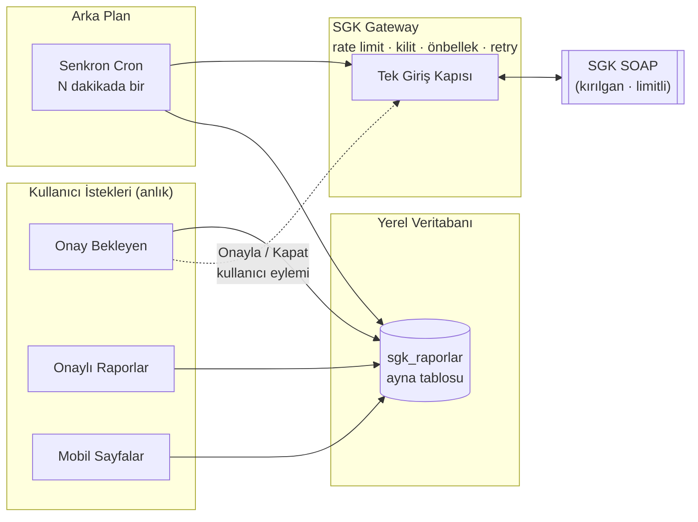

# SGK Vizite Servisi — Mimari Analiz ve Çözüm Önerisi

**Tarih:** 2026-07-31
**Durum:** Değerlendirme bekliyor (kod değişikliği yapılmadı)
**Kapsam:** `Core/Services/SgkViziteService.php` ve bu servisi kullanan tüm sayfa/cron/API katmanı

---

## 1. Yönetici Özeti

SGK servisinde yaşanan hatalar birbirinden bağımsız arızalar değil, **tek bir mimari kararın** sonucudur: uygulama, her sayfa açılışında canlı SGK SOAP servisine senkron olarak bağımlıdır. Bu nedenle **sayfanın güvenilirliği, SGK'nın güvenilirliğine eşittir.**

SGK servisi ise; dakikalık sorgu limiti, işveren başına tek oturum kısıtı, eksik dönen alanlar, sabit 100 kayıtlık pencere ve kararsız bağlantı davranışı olan bir servistir. Bu kısıtların hiçbiri uygulama tarafından değiştirilemez — ancak **etkileri mimariyle sınırlandırılabilir.**

**Öneri:** Sayfalar SGK'yı doğrudan çağırmayı bıraksın; yerel veritabanından okusun. SGK ile konuşan tek bileşen arka plan senkronizasyon cron'u olsun.

---

## 2. Doğrulanmış SGK Kısıtları

Aşağıdaki maddelerin tamamı bu projede gözlemlenmiş veya SGK cevabından birebir alınmıştır — varsayım değildir.

| # | Kısıt | Kanıt | Etkisi |
|---|---|---|---|
| K1 | `onayliRaporlarTarihile` **dakikada 1 sorgu** ile sınırlı | SGK cevabı: `"1 dakika aralıklar ile sorgulama yapabilirsiniz. !!!!"` (2026-07-31 log) | Arka arkaya sorguda servis hata veriyor |
| K2 | İşveren başına **tek aktif oturum** | `parseSgkError()` içinde `"aktif bir seans mevcuttur"` dalı | Farklı sekme/cihaz/IP çakışması |
| K3 | `ONAYLI`, `ONAYDURUMU`, `ONAY_TARIHI`, `RAPORDURUMADI` alanları **boş string** dönüyor | `raporAramaTarihile` ham cevap logu | Onay durumu bu alanlardan tespit edilemiyor |
| K4 | `raporAramaTarihile` **sabit 100 kayıtlık pencere** | `SgkViziteService.php:677` docstring | Pencereden düşen rapor sessizce kaybolur |
| K5 | Bağlantı kararsız; SGK bağlantıyı protokole uygun kapatmıyor | `SgkViziteService.php:78-82`, cURL hata 56 nedeniyle `file_get_contents` tercih edilmiş | Rastgele kesintiler |
| K6 | Timeout **180 saniye** | `sendRequest()` stream context | Sayfa uzun süre donabilir |
| K7 | `sonucKod = 503` "kayıt yok" demek, hata değil | `onayliRaporlariGetir()` | Hata ile boş sonuç ayırt edilmezse **sessiz hatalı davranış** |

### K3 + K4'ün birleşik sonucu

Bir rapor SGK'nın kendi portalinden onaylanırsa:
- `ARSIV` alanı `0` kalabiliyor,
- onay alanları boş geliyor (K3),
- yerel `onaylanan_raporlar` tablosunda kaydı olmuyor (uygulamadan onaylanmadığı için).

Yani **hiçbir yerel sinyal raporun onaylı olduğunu söylemiyor.** Tek doğrulama yolu `onayliRaporlarTarihile` servisidir — ki o da K1 ile sınırlıdır. Bu, 2026-07-31'de yaşanan hatanın tam mekanizmasıdır.

> **Not:** Kullanıcı teyidine göre `ARSIV = 1` olan raporlar SGK tarafında onaylanmış/sonuçlanmış raporlardır. Ancak yukarıdaki örnekte görüldüğü gibi `ARSIV = 0` olması "onaylı değil" anlamına **gelmiyor**.

---

## 3. Mevcut Mimarinin Sorunu

### 3.1 Bağlantı yüzeyi çok geniş

`new SgkViziteService()` çağrısı **37 ayrı noktada** yapılıyor: sayfalar, mobil sayfalar, API dosyaları, cron'lar ve web kökündeki tekil scriptler.

Bunun anlamı: rate limit, oturum kilidi, önbellek veya yeniden deneme gibi bir kural eklemek istediğinizde **37 yerin davranışını ayrı ayrı düşünmek** zorundasınız. Bugün eklenen önbellek yalnızca bir metodu koruyor; diğer 36 giriş noktası hâlâ korumasız.

### 3.2 Hata yönetimi kopyalanmış

`parseSgkError()` fonksiyonu iki dosyada **birebir kopyalanmış** durumda:
- `pages/onay_bekleyen_raporlar.php`
- `pages/onayli_raporlar.php`

Yeni bir SGK hata tipi (örn. K1 dakikalık limit) kullanıcıya anlamlı gösterilecekse iki dosyanın da güncellenmesi gerekiyor. Şu an dakikalık limit hatası için özel bir dal yok; kullanıcı genel "SGK Servis Hatası" mesajı görür.

### 3.3 Okuma ve yazma aynı kanalda yarışıyor

Kullanıcının bugün yaşadığı senaryo bu yarışın somut örneğidir:

1. Onay Bekleyen Raporlar açıldı → çapraz kontrol çalıştı, 17 rapordan 14'ü elendi → **3 rapor** (doğru)
2. Onaylı Raporlar sayfası sorgulandı → aynı servis tekrar çağrıldı, dakikalık hak tükendi
3. Bekleyen raporlara dönüldü → çapraz kontrol **K1'e takıldı**
4. Hata durumunda filtre kapatıldığı için → **17 rapor** (yanlış)

Kritik ders: **hata toleransı "filtreyi kapat" olarak tasarlanırsa, hata anında sistem sessizce yanlış veri gösterir.** Doğrusu, son bilinen doğru veriye düşmektir.

### 3.4 Veri kaybı riski (K4)

Bugün SGK'dan gelen 100 kayıtlık pencerenin dışına çıkan bir rapor, uygulamada **hiçbir iz bırakmadan** kaybolur. `arsivlenen_raporlar` tablosu (10 kayıt) yalnızca `ARSIV=1` olanları kapsıyor ve otomatik kapatma özelliği şu an bayrakla kapalı (`ARSIV_RAPORLARINI_OTOMATIK_KAPAT = false`). Yani genel bir güvenlik ağı yok.

---

## 4. Önerilen Mimari: Yerel Ayna + Arka Plan Senkronizasyonu

### 4.1 Hedef

> Sayfalar SGK'yı hiç çağırmasın. Yerel veritabanından okusun. SGK ile konuşan tek bileşen arka plan cron'u olsun.

### 4.2 Katmanlar

#### Katman 1 — SGK Gateway (tek giriş kapısı)

Tüm SGK çağrıları tek bir sınıftan geçer. Sorumlulukları:

- **Metot bazlı rate limit:** `onayliRaporlarTarihile` için ≥ 60 sn zorunlu bekleme (K1). Limit kodda merkezî tanımlanır.
- **İşyeri bazlı kilit:** Aynı işyeri için eşzamanlı SGK çağrısı engellenir (K2). Dosya kilidi (`flock`) yeterli; mevcut token önbellek dizini bu iş için uygun.
- **Önbellek:** Yanıtlar TTL ile saklanır; tekrarlanan sorgu SGK'ya gitmez.
- **Yeniden deneme:** Geçici bağlantı hataları için geri-çekilmeli retry (K5).
- **Tek tip hata sınıflandırma:** `parseSgkError()` buraya taşınır, kopyalar silinir; K1 ve K7 için özel dallar eklenir.

**Bu katman tek başına da değerlidir:** Ayna tablosuna hiç dokunmadan, bugünkü limit ve oturum hatalarının çoğunu bitirir. Veritabanı değişikliği gerektirmez, geri alması kolaydır.

#### Katman 2 — `sgk_raporlar` ayna tablosu

SGK'dan gelen tüm raporların yerel aynası. Mevcut `arsivlenen_raporlar` tablosu bu desenin küçük bir örneği; aynı yaklaşım genelleştirilir.

Taşıması gereken bilgi:
- SGK'nın döndürdüğü ham alanlar (`MEDULARAPORID` tekil anahtar)
- İşyeri/kullanıcı ilişkisi
- **Türetilmiş onay durumu:** `bekliyor` / `sgk_onayli` / `uygulamadan_onayli` / `kapatildi`
- Senkron meta verisi: ilk görülme, son görülme, son senkron zamanı

Faydaları:
- Onaylı ↔ bekleyen çapraz kontrolü **yerel SQL JOIN**'e dönüşür — ekstra SOAP çağrısı, rate limit ve önbellek karmaşası tamamen ortadan kalkar
- K4'teki veri kaybı riski kapanır: pencereden düşen rapor yerelde kalır
- Sayfalar milisaniyeler içinde açılır

> Veritabanı değişikliği, proje kuralı gereği **ayrı SQL scripti** olarak verilecektir.

#### Katman 3 — Senkron cron'u ve sayfaların yerelden okuması

- Mevcut cron altyapısı yeniden kullanılır: `CronCalismaModel` (çalışma takibi), `CronReporter`, `FileLogger`, çok-işyeri döngüsü — hepsi hazır.
- Sayfalar `SgkViziteService` yerine `RaporModel` üzerinden okur.
- Kullanıcıya **"Şimdi Yenile"** butonu verilir: isteğe bağlı senkron tetikler, Gateway limitlerine saygı duyar, limit doluysa "en son X dakika önce güncellendi" bilgisi gösterir.
- **Yazma işlemleri (Onayla / Kapat / İptal) canlı kalır** — bunlar kullanıcı tetikli tekil eylemlerdir, gecikmeye tolere edilemez. Başarılı yazma sonrası ayna tablosu anında güncellenir.

---

## 5. Aşamalı Uygulama Planı

| Aşama | İçerik | Risk | Kazanım |
|---|---|---|---|
| **1** | SGK Gateway katmanı; `parseSgkError` birleştirme; rate limit + kilit + retry | Düşük — DB değişikliği yok, geri alınabilir | Limit/oturum hatalarının çoğu biter |
| **2** | `sgk_raporlar` ayna tablosu + senkron cron'u (ayrı SQL scripti) | Orta — yeni tablo, cron yükü | Veri kaybı riski kapanır, çapraz kontrol yerelleşir |
| **3** | Sayfaların yerelden okuması + "Şimdi Yenile" | Orta-Yüksek — 37 çağrı noktası kademeli taşınır | Sayfalar anlık açılır, SGK kesintisi kullanıcıyı etkilemez |

Aşamalar bağımsız değer üretir; 1'de durulup değerlendirme yapılabilir.

---

## 6. Riskler ve Açık Sorular

**Riskler**

- **Otomatik onay cron'u etkilenir.** `bekleyenRaporlariGetir()` hem panel sayfaları hem `cron_otomatik_onay_bildirim.php` tarafından kullanılıyor. Buradaki her değişiklik ikisini birden etkiler; onay gibi geri dönüşü olmayan bir işlemde bu kritiktir. Aşama 1 ve 2 sonrası cron ayrıca test edilmelidir.
- **Bayat veri.** Ayna tablosu senkron aralığı kadar geride kalır. Onay bekleyen raporlar için birkaç dakikalık gecikme kabul edilebilir; kullanıcıya "son güncelleme" zamanı açıkça gösterilmelidir.
- **Cron yükü.** Her işyeri için periyodik SGK sorgusu, işyeri sayısıyla doğru orantılı artar. Senkron aralığı ve işyeri başına bütçe ölçülmelidir.

**Açık sorular**

1. K1 (dakikalık limit) yalnızca `onayliRaporlarTarihile` için mi geçerli, yoksa diğer metotlarda da var mı? Gateway'in limit tablosu buna göre şekillenir.
2. Rate limit işyeri bazında mı, kullanıcı bazında mı, yoksa IP bazında mı uygulanıyor? Çok işyerili senkron cron'unun tasarımı buna bağlı.
3. Senkron aralığı ne olmalı? (öneri: 10–15 dk; onay bekleyen raporlar için yeterli tazelik)

---

## 7. Bu Dokümanın Dışında Kalan — Ama Acil — Bulgu

Bu analiz sırasında, SGK kullanım noktaları taranırken web kökünde **git'te takipli** üç dosya tespit edildi:

| Dosya | Bulgu |
|---|---|
| `rapor_detay.php` | Kod içinde **canlı SGK kimlik bilgileri**; yetki/session kontrolü yok; POST ile SGK'da onay işlemi yapıyor |
| `test.php` | Kod içinde **canlı SGK kimlik bilgileri**; yetki kontrolü yok |
| `temizle.php` | Yetki kontrolü yok; döngüyle SGK'da **toplu rapor kapatıyor** (geri dönüşü olmayan işlem) |

Bu durum proje güvenlik kurallarından üçünü ihlal ediyor: hardcoded şifre yasağı, web kökünde test/debug scripti bırakmama, yetki kontrolsüz PHP dosyası olmaması.

**Önerilen aksiyon:**
1. Söz konusu SGK şifrelerinin **sızmış kabul edilip SGK tarafında değiştirilmesi** — dosyayı silmek yeterli değildir, git geçmişinde kalır.
2. `test.php` ve `temizle.php` dosyalarının kaldırılması.
3. `rapor_detay.php` hâlâ kullanımdaysa kimlik bilgilerinin session/`.env`'e taşınması ve `Security::checkLogin()` + yetki kontrolü eklenmesi; kullanımda değilse kaldırılması.

Bu maddeler mimari refactor'dan bağımsızdır ve **ondan önce** ele alınmalıdır.
